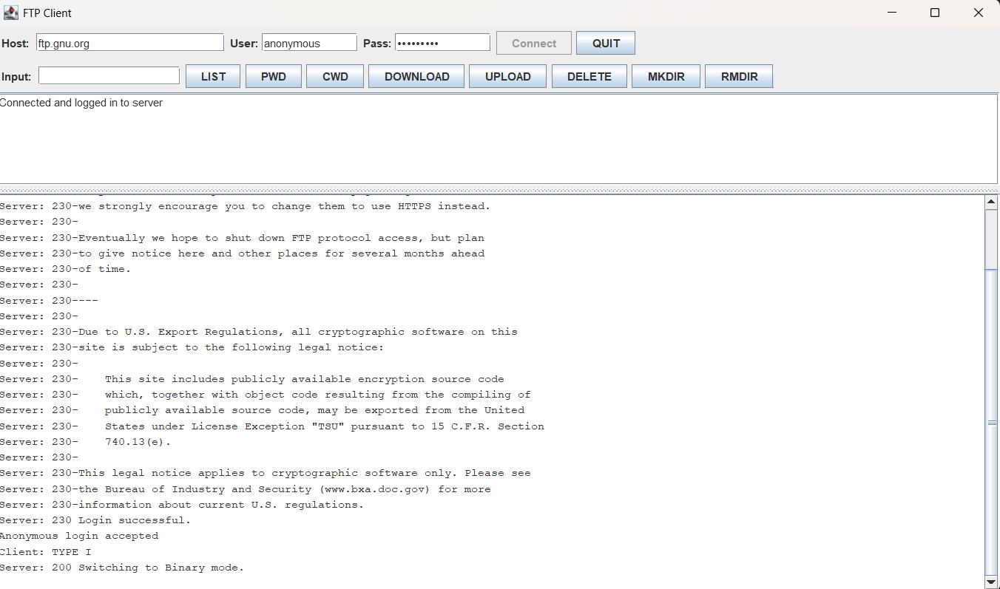
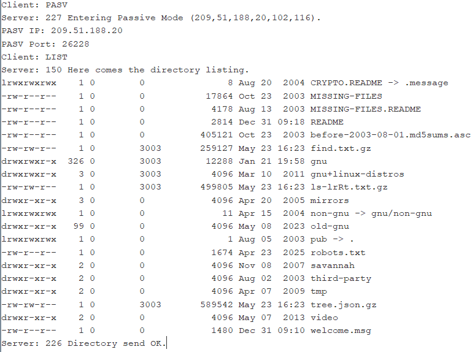
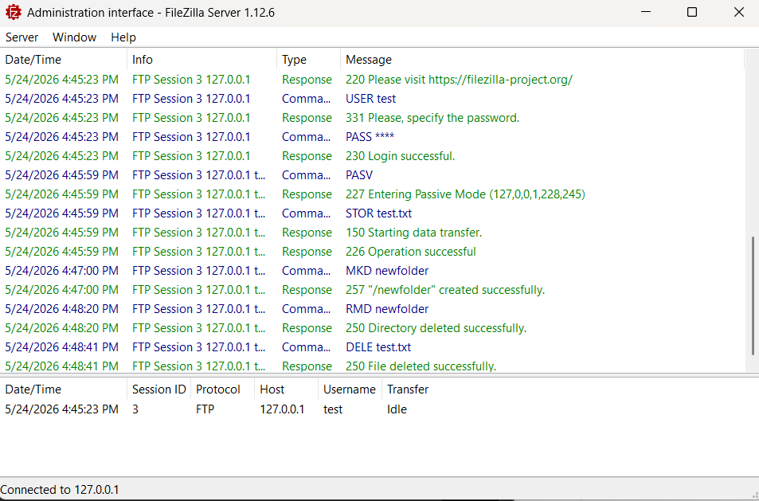

# FTP Client in Java

A graphical FTP client written from scratch in Java using raw sockets. It implements the FTP protocol directly (control connection, passive-mode data connections, multiline reply parsing) with **no third-party FTP libraries**, only `java.io`, `java.net`, and Swing for the GUI.

Built as a Computer Networks course project.


<!-- TODO: take a screenshot of the running GUI and save it as screenshots/gui.png -->

## Features

| Command | FTP verbs | Notes |
|---|---|---|
| Connect / login | `USER`, `PASS` | Anonymous or custom credentials, default port 21 |
| Print / change directory | `PWD`, `CWD` | |
| List files | `PASV` + `LIST` | Output shown in the protocol log |
| Download | `PASV` + `RETR` | Streams bytes to a local file |
| Upload | `PASV` + `STOR` | Validates the local file first |
| Delete file | `DELE` | |
| Create / remove directory | `MKD`, `RMD` | |
| Disconnect | `QUIT` | Closes streams and sockets |

Other highlights:

- **Separate control and data connections**, as the protocol requires.
- **Multiline reply parsing** (`250-...` continuation lines until `250 `), needed for servers like `ftp.gnu.org` and FileZilla.
- **Live protocol log** in the GUI showing the raw `Client:` / `Server:` exchange, next to a simplified status panel.
- **Responsive UI:** every network operation runs on its own thread, so the window never freezes during transfers.

## How it works

```
 GUI.java  ──calls──▶  FTPClient.java  ──control socket (port 21)──▶  FTP server
    ▲                        │
    └──── protocolLog() ─────┤──data socket (PASV port)───────────────▶  LIST / RETR / STOR data
```

- `FTPClient` owns the sockets, sends commands, and parses replies.
- `GUI` builds the Swing window and calls `FTPClient`; `FTPClient` pushes log lines back to the GUI.

**Passive mode:** the server answers `PASV` with `227 Entering Passive Mode (h1,h2,h3,h4,p1,p2)`. The client opens a data socket to `h1.h2.h3.h4` on port `p1 * 256 + p2`, then sends `LIST`, `RETR`, or `STOR` on the control connection.

Example session against `ftp.gnu.org`:



The full write-up (architecture, protocol flow, test screenshots) is in [`docs/FTP_Client_Project_Report.docx`](docs/FTP_Client_Project_Report.docx).

## Project structure

```
ftp-client-java/
├── src/
│   ├── FTPClient.java   # protocol + networking logic
│   └── GUI.java         # Swing interface and entry point
├── docs/
│   └── FTP_Client_Project_Report.docx
├── screenshots/
└── README.md
```

## Build and run

Requires **Java 8 or later** (a JDK, so that `javac` is available).

```bash
# from the repository root
javac -d out src/*.java
java -cp out GUI
```

The window opens with these defaults:

- Host: `ftp.gnu.org`
- User: `anonymous`
- Password: `anonymous`

Click **Connect**, then use the buttons. For `CWD`, `DOWNLOAD`, `UPLOAD`, `DELETE`, `MKDIR` and `RMDIR`, type the path or file name in the **Input** field first.

## Testing

| Server | Verified |
|---|---|
| `ftp.gnu.org` (public) | Anonymous login, `LIST`, `PWD`, `CWD`, `RETR`, multiline replies |
| FileZilla Server (local) | `STOR`, `MKD`, `RMD`, `DELE` |

Public servers deny write operations, so `STOR`, `DELE`, `MKD` and `RMD` return permission errors on `ftp.gnu.org`. To try them, run a local FTP server such as [FileZilla Server](https://filezilla-project.org/) and connect to `127.0.0.1`.

Server-side view of a local write-operations session:



## Tech

Java · Socket programming · FTP (RFC 959) · Swing · Multithreading

## License

MIT, see [LICENSE](LICENSE).
